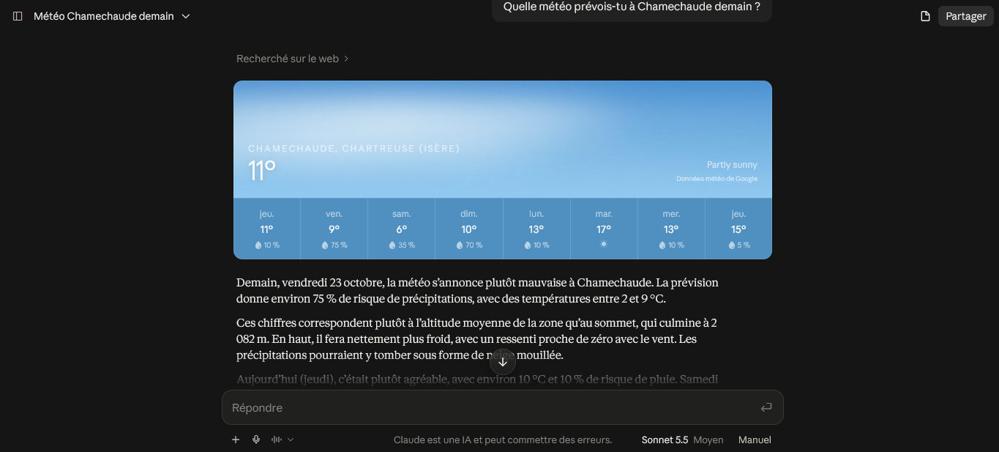

# mcp-montagne


Un serveur [MCP](https://modelcontextprotocol.io) (Model Context Protocol) en Node.js et TypeScript qui donne à Claude des outils pour **préparer une sortie en montagne dans les Alpes françaises** : météo à l'altitude d'un sommet et bulletin d'estimation du risque d'avalanche (BRA) de Météo-France.

Plutôt que de jongler entre plusieurs sites pour décider si une sortie est raisonnable, on pose la question à Claude, qui interroge les sources officielles et résume.



> **Important : outil indicatif.** Ce projet ne remplace ni le bulletin officiel de Météo-France, ni le jugement sur le terrain, ni un professionnel de la montagne. Consultez toujours le bulletin complet avant de partir.

## Pourquoi ce projet

Pour une sortie en montagne, les informations utiles sont éparpillées : bulletin d'avalanche, météo par altitude, isotherme 0 °C, vent en crête. J'ai cherché ce qui existait déjà sous forme de serveurs MCP : on trouve des serveurs pour les stations de ski, les sentiers suisses ou le bulletin américain, mais je n'en ai pas trouvé s'appuyant sur le BRA français. Ce projet comble ce manque pour les massifs autour de Grenoble et, plus largement, les Alpes françaises.

## Fonctionnalités

| Outil | Rôle |
|---|---|
| `meteo_sommet` | Météo à l'altitude d'un sommet : conditions actuelles, ou prévision de la journée pour aujourd'hui, demain, après-demain et dans trois jours (température, vent, rafales, nuages, isotherme 0 °C, neige). Source : Open-Meteo. |
| `bulletin_avalanche` | Bulletin d'estimation du risque d'avalanche d'un massif : risque maximal et par altitude, orientations de pentes dangereuses, tendance à J+2, stabilité du manteau, enneigement, neige fraîche, aperçu météo. Source : Météo-France. |

Exemples de questions à poser à Claude :

- « Quelle météo prévois-tu à Chamechaude demain ? »
- « Est-ce qu'il y a du vent au Moucherotte cet après-midi ? »
- « Quel est le risque d'avalanche dans Belledonne ? »
- « Je pense aller à Chamechaude ce week-end, qu'est-ce que je dois regarder ? »

Couverture : les sommets définis dans `src/sommets.ts` (dont Chamechaude et le Moucherotte, facile à compléter) et les 23 massifs alpins du bulletin (identifiants de l'annexe officielle de Météo-France).

## Prérequis

- Node.js 22 ou plus récent (testé avec Node 22)
- [Claude Desktop](https://claude.ai/download) (les serveurs MCP locaux se déclarent dans son fichier de configuration)
- Un compte gratuit sur le [portail des API de Météo-France](https://portail-api.meteofrance.fr), avec une clé d'API pour le bulletin d'avalanche (voir ci-dessous)

## Installation

```bash
git clone https://github.com/TON-PSEUDO/mcp-montagne.git
cd mcp-montagne
npm install
npm run build
```

### 1. Obtenir une clé d'API Météo-France

1. Créer un compte sur [portail-api.meteofrance.fr](https://portail-api.meteofrance.fr).
2. Souscrire à l'API **Bulletin Avalanche** (« DonneesPubliquesBRA »).
3. Créer une application et générer une clé de type **API Key**.
4. Créer à la racine du projet un fichier `.env` :

```
METEOFRANCE_API_KEY=votre-cle-ici
```

Le fichier `.env` est exclu de Git : **ne publiez jamais votre clé**. L'outil météo (Open-Meteo) ne nécessite aucune clé.

### 2. Déclarer le serveur dans Claude Desktop

Dans Claude Desktop, ouvrir **Paramètres > Développeur > Modifier la configuration**, puis ajouter le serveur dans `mcpServers` avec le **chemin absolu** vers `dist/index.js` :

```json
{
  "mcpServers": {
    "montagne": {
      "command": "node",
      "args": ["C:\\chemin\\vers\\mcp-montagne\\dist\\index.js"]
    }
  }
}
```

Sous macOS ou Linux : `"/chemin/vers/mcp-montagne/dist/index.js"`. Le serveur retrouve tout seul le fichier `.env` à la racine du projet.

Quittez ensuite **complètement** Claude Desktop (y compris son icône dans la zone de notification), relancez-le, puis vérifiez dans **Paramètres > Développeur** que `montagne` est « En cours ».

## Lancer avec Docker

```bash
docker build -t mcp-montagne .
docker run -i --rm --env-file .env mcp-montagne
```

La clé d'API est transmise au démarrage via `--env-file` et n'est jamais copiée dans l'image (le fichier `.env` est exclu par `.dockerignore`).

## Développement

```bash
npm run dev     # lance le serveur directement depuis le TypeScript
npm run build   # compile vers dist/
npm test        # lance les tests (Vitest)
```

Pour tester les outils sans passer par Claude, l'[MCP Inspector](https://github.com/modelcontextprotocol/inspector) permet d'appeler chaque outil à la main :

```bash
npx @modelcontextprotocol/inspector node dist/index.js
```

### Structure

```
src/
  index.ts        déclaration du serveur et des outils MCP
  sommets.ts      liste des sommets (nom, massif, coordonnées, altitude)
  massifs.ts      identifiants officiels des massifs du BRA
  meteo.ts        appels à Open-Meteo (conditions actuelles et prévisions)
  bra.ts          appel à l'API Météo-France, détection du hors-saison
  bra-parser.ts   lecture du XML du bulletin
  bra-format.ts   mise en forme du bulletin pour Claude
tests/
  fixtures/       bulletin d'archive réel (Belledonne) utilisé par les tests
```

### Choix techniques

- **Données séparées de la logique** : ajouter un sommet, c'est ajouter une entrée dans `src/sommets.ts`, sans toucher au code.
- **Le hors-saison est une réponse normale, pas une erreur** : de l'été au début novembre, l'API renvoie un message à la place du bulletin. L'outil l'indique clairement à l'utilisateur.
- **Erreurs explicites** : sommet ou massif inconnu (avec la liste des valeurs valides), clé manquante, API indisponible. L'outil renvoie un message exploitable plutôt que de planter.
- **Tests sans réseau** : l'analyse du bulletin est testée sur un vrai bulletin d'archive, et les appels à l'API sont simulés, donc les tests ne dépendent ni d'Internet ni d'une clé d'API.
- **Rappel de sécurité systématique** dans chaque bulletin restitué, avec la source.

## Limites connues

- **Saisonnalité du bulletin** : Météo-France le publie de novembre à la fin de la saison de ski (mai à début juin). En dehors, `bulletin_avalanche` renvoie le message officiel « saison terminée ».
- **Sommets en nombre limité** : seuls ceux de `src/sommets.ts` sont reconnus. Les massifs couverts sont ceux des Alpes ; les Pyrénées et la Corse ne sont pas intégrés.
- **Précision de la météo** : les prévisions viennent de modèles dont la maille fait plusieurs centaines de mètres à quelques kilomètres, ajustées à l'altitude du sommet. Le vent est donné à 10 m au-dessus du sol : sur une crête exposée, la réalité peut être plus forte. Les rafales sont à regarder en priorité. Le code météo n'est pas toujours cohérent avec la température en altitude.
- **Prévision limitée à 3 jours** après aujourd'hui.
- **Analyse du bulletin** validée sur un bulletin d'archive. Les balises de prévision de mer de nuages (`MERNUAGES`) n'ont pas encore été observées avec une valeur positive.

## Prochaines étapes

- [ ] Test en conditions réelles du flux de l'API à la reprise de la saison
- [ ] Prévision de **mer de nuages** : lecture de l'altitude fournie dans le bulletin (`MERNUAGES`), puis estimation à partir des niveaux de pression d'Open-Meteo en dehors de la saison
- [ ] Outil de synthèse combinant météo et bulletin pour un sommet donné
- [ ] Dockerfile et intégration continue (GitHub Actions)
- [ ] Publication sur npm
- [ ] Plus de sommets, et mise en cache des réponses

## Sources et licences

- **Bulletin d'estimation du risque d'avalanche** : © Météo-France, publié sous [Licence Ouverte 2.0](https://www.etalab.gouv.fr/licence-ouverte-open-licence/), via le portail des API de Météo-France.
- **Données météo** : Weather data by [Open-Meteo.com](https://open-meteo.com/), sous licence [CC BY 4.0](https://creativecommons.org/licenses/by/4.0/). L'API gratuite d'Open-Meteo est réservée à un usage non commercial et soumise à des quotas.

## Auteure

Ashwi Dipen — [ashwidipen.com](https://www.ashwidipen.com)
